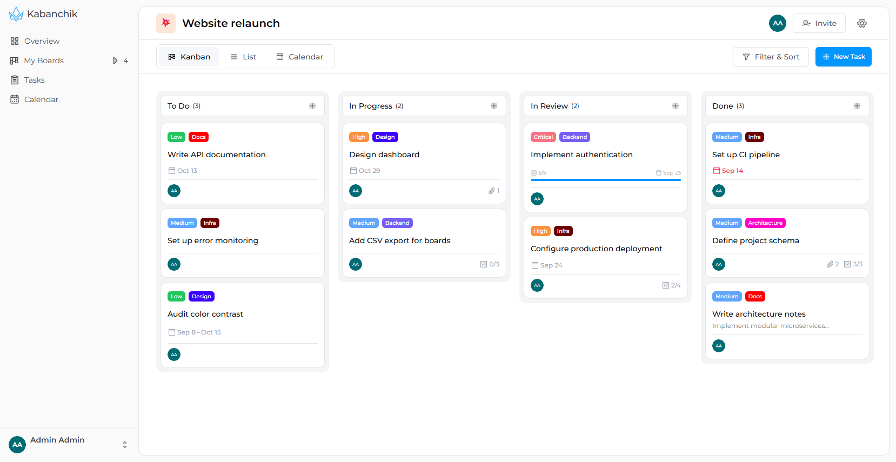

<p align="center">
    
</p>

<h1 align="center">Kanbanchik Kanban Board</h1>

<h3 align="center">An open-source Kanban workspace for planning, tracking and shipping team projects.</h3>

<p align="center">
    <a href="https://github.com/EisOokami/KanbanchikKanbanBoard/stargazers"></a>
    <a href="https://github.com/EisOokami/KanbanchikKanbanBoard/commits"></a>
    <a href="./LICENSE"></a>
    <a href="https://github.com/EisOokami"></a>
</p>

<h4 align="center">🚧 Status: in active development 🚧</h4>

<p align="center">
    <a href="#about">About</a> •
    <a href="#features">Features</a> •
    <a href="#layout">Layout</a> •
    <a href="#started">Getting Started</a> •
    <a href="#tech">Tech Stack</a> •
    <a href="#contribute">Contribute</a> •
    <a href="#author">Author</a> •
    <a href="#license">License</a>
</p>

<h2 id="about">📖 About</h2>

**Kanbanchik** keeps boards, tasks, deadlines and reporting in one workspace, so nothing hides in a side spreadsheet. Create a project, shape its workflow with your own columns, invite your team and move work from idea to done.

The repository contains two applications:

| Folder      | What it is                                                                                    |
| ----------- | --------------------------------------------------------------------------------------------- |
| `frontend/` | Next.js web app: landing page, authentication, boards, task views, calendar and settings      |
| `backend/`  | Express REST API on MariaDB: accounts, projects, tasks, uploads, invites and security logging |

<h2 id="layout">🎨 Layout</h2>

<p align="center">
    <picture>
        <source media="(prefers-color-scheme: dark)" srcset="frontend/public/preview-kanban-dark.png" />
        
    </picture>
</p>

<h2 id="started">🚀 Getting Started</h2>

You can run the whole stack with Docker Compose or start each part locally.

<h3>Prerequisites</h3>

- [Git](https://git-scm.com)
- [Docker](https://www.docker.com/) with Docker Compose, **or** for a local setup:
    - [Node.js](https://nodejs.org/) 22 or newer with npm
    - [pnpm](https://pnpm.io/) (the frontend is managed with pnpm, `corepack enable pnpm` is enough)
    - [MariaDB](https://mariadb.org/)
- Optional: a Google OAuth client (Google sign-in) and an SMTP mailbox (verification emails). For the AI features each user adds their own [Gemini API key](https://aistudio.google.com/apikey) in the app

<h3>Cloning</h3>

```bash
git clone https://github.com/EisOokami/KanbanchikKanbanBoard.git
cd KanbanchikKanbanBoard
```

<h3>Environment variables</h3>

Docker Compose reads its values from a `.env` file in the project root. For a local setup, put the backend values into `backend/.env` and the frontend values into `frontend/.env`. Commented templates: `.env.example` (Docker-only values), `backend/.env.example` and `frontend/.env.example`.

**Backend**

| Variable                                                            | Description                                                                                                                                                                                                                                                                                                         |
| ------------------------------------------------------------------- | ------------------------------------------------------------------------------------------------------------------------------------------------------------------------------------------------------------------------------------------------------------------------------------------------------------------- |
| `NODE_ENV`, `PORT`                                                  | Runtime mode and API port (`3001`)                                                                                                                                                                                                                                                                                  |
| `DB_HOST`, `DB_PORT`, `DB_NAME`, `DB_USER`, `DB_PASSWORD`           | MariaDB connection. `backend/database/database.sql` creates the `kanbanchik_board` database, so use that name. In Docker the database port is published on `127.0.0.1` only                                                                                                                                         |
| `DB_ROOT_PASSWORD`                                                  | Root password for the MariaDB container (Docker only)                                                                                                                                                                                                                                                               |
| `JWT_ACCESS_SECRET`, `JWT_REFRESH_SECRET`                           | Secrets for signing access and refresh tokens                                                                                                                                                                                                                                                                       |
| `CSRF_SECRET`                                                       | Secret for CSRF tokens                                                                                                                                                                                                                                                                                              |
| `MFA_ENCRYPTION_KEY`                                                | Encrypts stored 2FA secrets, at least 32 characters                                                                                                                                                                                                                                                                 |
| `LOGIN_CODE_SECRET`, `DELETION_CODE_SECRET`, `TRANSFER_CODE_SECRET` | Sign the email codes for login, account deletion and ownership transfer                                                                                                                                                                                                                                             |
| `EMAIL_SERVICE`, `EMAIL_USER`, `EMAIL_PASSWORD`                     | Mailbox used by Nodemailer                                                                                                                                                                                                                                                                                          |
| `FRONTEND_URL`, `BACKEND_URL`                                       | Public URLs of both apps, used in emails and redirects                                                                                                                                                                                                                                                              |
| `CORS_URLS`, `HOSTS`                                                | Comma-separated allowed origins and hosts, e.g. `http://localhost:3000` and `localhost:3001`                                                                                                                                                                                                                        |
| `TRUST_PROXY`                                                       | Comma-separated addresses or subnets of trusted proxies in front of the API, e.g. the reverse proxy or the Next.js server (`loopback`, `172.18.0.0/16`), or a number of proxy hops. Only these may set `X-Forwarded-For`; unset means the header is ignored. `true` is treated as one hop: prefer the proxy address |
| `GOOGLE_CLIENT_ID`, `GOOGLE_CLIENT_SECRET`, `GOOGLE_REDIRECT_URI`   | Google sign-in. The redirect URI is `<API URL>/auth/google/callback`                                                                                                                                                                                                                                                |
| `TERMS_VERSION`, `PRIVACY_VERSION`                                  | **Required.** Versions of the published Terms of Service and Privacy Policy (`/terms`, `/privacy`). After a bump every account accepts the new versions: at the next password or Google sign-in, or in a dialog if it is already signed in                                                                          |
| `LOG_LEVEL`, `LOG_FILE`, `LOG_RETENTION_DAYS`                       | Log level and optional log file. With `LOG_FILE=/var/logs/app/app.log` (Docker; locally e.g. `./logs/app.log`) the API writes one file per day (`app-YYYY-MM-DD.log`), which Promtail sends to Grafana, and deletes files older than `LOG_RETENTION_DAYS` (default `30`)                                            |
| `GEMINI_MODEL`                                                      | Gemini model for the AI features (default `gemini-3.5-flash-lite`). There is no server key: each user adds their own Gemini API key in **Account settings -> AI**; it stays in their browser and is sent only with their AI requests                                                                                |
| `FILE_URL_SECRET`, `FILE_URL_TTL_HOURS`                             | Uploaded files are served only through signed, expiring links that the API hands out to project members. Secret for the signatures (defaults to `JWT_ACCESS_SECRET`) and link lifetime in hours (default `24`, max `168`)                                                                                           |
| `MAX_INVITES_PER_DAY`                                               | Invitation emails one user can send per 24 hours (default `50`); one request accepts at most 20 addresses                                                                                                                                                                                                           |
| `RETENTION_CLEANUP`                                                 | Set to `false` to disable the hourly clean-up of expired invitations, sessions, one-time codes and never-verified accounts                                                                                                                                                                                          |
| `LEGAL_CONTROLLER_NAME`, `LEGAL_CONTACT_EMAIL`                      | Data controller named in invitation emails (defaults: the operator from the Privacy Policy)                                                                                                                                                                                                                         |

**Frontend**

| Variable                                                                                                               | Description                                                                                                                                                                                                                      |
| ---------------------------------------------------------------------------------------------------------------------- | -------------------------------------------------------------------------------------------------------------------------------------------------------------------------------------------------------------------------------- |
| `API_URL`                                                                                                              | API address for server-side requests, e.g. `http://localhost:3001`                                                                                                                                                               |
| `NEXT_PUBLIC_API_URL`                                                                                                  | API address used by the browser (Google sign-in link)                                                                                                                                                                            |
| `NEXT_PUBLIC_INTERNAL_API_URL`                                                                                         | API address contained in file links when the API is reached internally (e.g. in Docker); attachment previews replace it with `NEXT_PUBLIC_API_URL`                                                                               |
| `HOST`                                                                                                                 | No longer used: session cookies are host-only (no `Domain`)                                                                                                                                                                      |
| `CLIENT_IP_HEADER`                                                                                                     | Header with the real client IP set by the reverse proxy in front of Next.js (e.g. `x-real-ip`). It is forwarded to the API so rate limits count each client separately. Next.js must be reachable only through that proxy        |
| `INTERNAL_IMG_SRC_URL`, `INTERNAL_CONNECT_SRC_URL`                                                                     | Extra sources allowed by the Content Security Policy (space or comma separated), e.g. the API origin for images. Google profile photos (`*.googleusercontent.com`) and the emoji data from `cdn.jsdelivr.net` are always allowed |
| `API_PROTOCOL`, `API_HOSTNAME`, `API_PORT`                                                                             | Where uploaded images are served from (Next.js image optimization)                                                                                                                                                               |
| `ADDITIONAL_PROTOCOL`, `ADDITIONAL_HOSTNAME`, `ADDITIONAL_PORT`                                                        | A second allowed image source                                                                                                                                                                                                    |
| `TERMS_VERSION`, `PRIVACY_VERSION`                                                                                     | Versions shown on `/terms` and `/privacy` (default `1.0`). Keep them equal to the API values                                                                                                                                     |
| `NEXT_PUBLIC_SITE_URL`                                                                                                 | Public address of the service shown in the Privacy Policy and Terms of Service                                                                                                                                                   |
| `LEGAL_OPERATOR`, `LEGAL_CONTACT_EMAIL`                                                                                | Operator (data controller) and contact e-mail named in `/privacy` and `/terms`                                                                                                                                                   |
| `LEGAL_SERVER_PROVIDER`, `LEGAL_BACKUP_RETENTION`                                                                      | Server provider and country, and backup retention named in the Privacy Policy. Empty `LEGAL_*` values are shown on the pages as highlighted `[DO UZUPEŁNIENIA: …]` placeholders.                                                 |
| `LEGAL_LAST_TERMS_UPDATED`, `LEGAL_EFFECTIVE_TERMS_DATE`, `LEGAL_LAST_PRIVACY_UPDATED`, `LEGAL_EFFECTIVE_PRIVACY_DATE` | Dates shown in the Terms of Service and Privacy Policy, e.g. `20 listopada 2026 r.`                                                                                                                                              |
| `LEGAL_REPOSITORY_URL`, `LEGAL_LICENSE_URL`                                                                            | Repository and license links in the Terms of Service (default: this repository on GitHub)                                                                                                                                        |

For Grafana, also set `GRAFANA_ADMIN_USER`, `GRAFANA_ADMIN_PASSWORD`, `GRAFANA_ALLOW_SIGN_UP` and `GRAFANA_INSTALL_PLUGINS` in the root `.env`.

<h3>Starting with Docker</h3>

```bash
# production-like build
docker compose up -d --build

# development mode with hot reload
docker compose -f docker-compose.dev.yml up --build
```

MariaDB applies `backend/database/database.sql` on its first start. Uploaded files are kept in `backend/uploads` and logs in `backend/logs` on the host; include `backend/uploads` in your backups. The directories must be writable by the container user (`node`, uid 1000).

MariaDB (`3306`), Loki (`3100`) and Grafana (`3200`) are published on `127.0.0.1` only. Reach Grafana through an SSH tunnel or your reverse proxy.

Database changes for existing installations are in `backend/database/migrations/` (for example, removing the unused `activity_log` and `audit_logs` tables).

| Service  | URL                                            |
| -------- | ---------------------------------------------- |
| Frontend | [http://localhost:3000](http://localhost:3000) |
| API      | [http://localhost:3001](http://localhost:3001) |
| Grafana  | [http://localhost:3200](http://localhost:3200) |

<h3>Starting locally</h3>

Create the database once:

```bash
mariadb -u root -p < backend/database/database.sql
```

Start the API in one terminal:

```bash
cd backend
npm install
npm run dev        # or: npm run build && npm start
```

Start the web app in a second terminal:

```bash
cd frontend
pnpm install
pnpm dev
```

Open [http://localhost:3000](http://localhost:3000).

<h3>Useful scripts</h3>

| Where       | Command                       | What it does                       |
| ----------- | ----------------------------- | ---------------------------------- |
| `backend/`  | `npm run dev`                 | Start the API with hot reload      |
| `backend/`  | `npm run build` / `npm start` | Compile TypeScript and run `dist/` |
| `frontend/` | `pnpm dev`                    | Start Next.js in development mode  |
| `frontend/` | `pnpm build` / `pnpm start`   | Production build and server        |
| `frontend/` | `pnpm lint`                   | Run ESLint                         |

<h2 id="tech">💻 Tech Stack</h2>

#### **Frontend** ([Next.js 16](https://nextjs.org/) + [React 19](https://react.dev/) + [TypeScript](https://www.typescriptlang.org/))

- **[Tailwind CSS](https://tailwindcss.com/)** with **[shadcn/ui](https://ui.shadcn.com/)** and **[Radix UI](https://www.radix-ui.com/)**
- **[dnd kit](https://dndkit.com/)** for drag-and-drop
- **[React Day Picker](https://daypicker.dev/)** and **[date-fns](https://date-fns.org/)** for dates
- **[Zod](https://zod.dev/)** for validation
- **[next-themes](https://github.com/pacocoursey/next-themes)**, **[Sonner](https://sonner.emilkowal.ski/)**, **[Yet Another React Lightbox](https://yet-another-react-lightbox.com/)**, **[Frimousse](https://frimousse.liveblocks.app/)**, **[React Color](https://uiwjs.github.io/react-color/)**
- **[Phosphor Icons](https://phosphoricons.com/)** and **[Lucide](https://lucide.dev/)**

> See [frontend/package.json](./frontend/package.json)

#### **Backend** ([Node.js](https://nodejs.org/) + [Express 5](https://expressjs.com/) + [TypeScript](https://www.typescriptlang.org/))

- **[MariaDB](https://mariadb.org/)** through **[mysql2](https://github.com/sidorares/node-mysql2)**
- **[jose](https://github.com/panva/jose)** (JWT), **[bcryptjs](https://github.com/dcodeIO/bcrypt.js)**, **[otplib](https://github.com/yeojz/otplib)** and **[qrcode](https://github.com/soldair/node-qrcode)** for authentication and 2FA
- **[Google Auth Library](https://github.com/googleapis/google-auth-library-nodejs)** for Google sign-in
- **[Google Gen AI SDK](https://github.com/googleapis/js-genai)** for the AI assistant
- **[Multer](https://github.com/expressjs/multer)** and **[file-type](https://github.com/sindresorhus/file-type)** for uploads
- **[Nodemailer](https://nodemailer.com/)** for emails
- **[Helmet](https://helmetjs.github.io/)**, **[express-rate-limit](https://github.com/express-rate-limit/express-rate-limit)**, **[hpp](https://github.com/analog-nico/hpp)**, **[express-xss-sanitizer](https://github.com/AhmedAdelFahim/express-xss-sanitizer)**, **[host-validation](https://github.com/brannondorsey/host-validation)**
- **[Pino](https://getpino.io/)** for logging
- **[Zod](https://zod.dev/)** for validation

> See [backend/package.json](./backend/package.json)

#### **Infrastructure**

- **[Docker Compose](https://docs.docker.com/compose/)** for the full stack
- **[Grafana](https://grafana.com/)**, **[Loki](https://grafana.com/oss/loki/)** and **[Promtail](https://grafana.com/docs/loki/latest/send-data/promtail/)** for log monitoring

<h2 id="contribute">📫 Contribute</h2>

1. Fork the project and clone your fork
2. Create a branch: `git checkout -b feature/your-feature`
3. Commit your changes following [Conventional Commits](https://www.conventionalcommits.org/) (`feat: ...`, `fix: ...`)
4. Push the branch: `git push origin feature/your-feature`
5. Open a Pull Request that explains the problem or feature, and add screenshots for visual changes

The repository includes templates for [bug reports, feature requests](./.github/ISSUE_TEMPLATE) and [pull requests](./.github/PULL_REQUEST_TEMPLATE.md).

<h3>Documentation that might help</h3>

[📝 How to create a Pull Request](https://docs.github.com/en/pull-requests/collaborating-with-pull-requests/proposing-changes-to-your-work-with-pull-requests/creating-a-pull-request)

[💾 Commit pattern](https://gist.github.com/joshbuchea/6f47e86d2510bce28f8e7f42ae84c716)

<h2 id="author">👤 Author</h2>

<table>
    <tr>
        <td align="center">
            <a href="https://github.com/EisOokami">
                <br />
                <sub><b>EisOokami</b></sub>
            </a>
        </td>
    </tr>
</table>

<h2 id="license">📝 License</h2>

This project is distributed under the [MIT License](./LICENSE).
